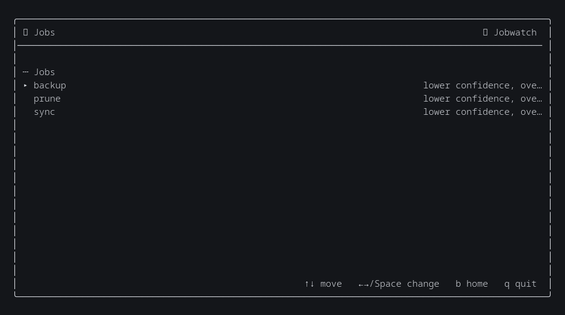

# jobwatch

Are my backup and sync jobs still working, and will they keep working? Without reading logs or checking cron.

Most backup failures are slow and predictable: data grows, runs take longer, the gap before the next job shrinks, and eventually one job overruns the next or is skipped. Jobwatch catches that early. **It never changes a schedule.**

A standalone terminal app, in the Mint family with [cairn](https://github.com/CurtisD4q/cairn) and susynth: one binary, no daemon, no database. The same program records your jobs and shows how they are doing.

## Two views of the same jobs



**The job list** — one word a job: `fine`, `overdue`, `failing`, `slowing`, `overrunning`, `new`, `running`, `lost`, `changed`. Next to it, when it last succeeded, and the worst finding. Open a job and you get the evidence: every finding about it, with the runs, the numbers and the test used.


**The day** — 24 hours across the width of the terminal, one bar a job: a solid run from its start to its usual end, a lighter tail out to its slowest recent run, and the gap from there to where the next job starts. A job whose slow tail reaches the next one has no gap, and runs into it.

Both read one check of one history, so the same job shows the same state and the same evidence whichever view you came from.

## Install

```
export GOPRIVATE='github.com/CurtisD4q/*'
go install github.com/CurtisD4q/jobwatch/cmd/jobwatch@main
```

Needs Go 1.21 or newer. The Mint packs it builds on are fetched by Go; CI needs a `MINT_READ_TOKEN` secret with read access to them.

Run `jobwatch`. With no arguments it opens the job list.

```
jobwatch                     open the job list
jobwatch --screen "The day"  open one screen directly
jobwatch --dir PATH          read a history kept somewhere other than ~/.local/share/mint-loom
jobwatch --version
```

The same program has commands for scripts and cron. `jobwatch help` lists them:

```
jobwatch record NAME -- COMMAND...   run a job and record the run
jobwatch check [--shadow] [--notify] alert on problems: for a timer or cron
jobwatch schedule SPEC --on          run the check on a schedule (--undo turns it off)
jobwatch report | forecast | timeline [--json]
jobwatch import journal --unit UNIT  read history jobwatch did not record
jobwatch respace                     suggest start times; nothing is applied
```

## Recording a job

Put `jobwatch record` in front of a crontab line. The command runs as given, its output and exit code pass straight through, so cron still mails a failure.

```
30 2 * * *  jobwatch record nightly-backup -- restic backup /data
```

Six weeks later the list says *"Nightly backup takes 31% longer per GB than 6 weeks ago (p = 0.01). The data has hardly changed, so it is slowing down, not growing."* Open it and you see the runs, the trend, and its slowest runs ending four minutes before the 03:00 sync starts. You move the sync by hand.

Jobs already in a systemd journal, an rclone or an rsync log can be read in with `jobwatch import`. Those runs are marked lower confidence, and the app says so.

## What it checks

The simple check catches most real failures: a job that hasn't succeeded in 1.5 times its period (plus ten minutes), or whose last run failed, is flagged with the failing step and the last line it printed.

The statistical checks are a second layer, for what the first cannot see:

- **Slowing, not growing.** Time per GB is tested for a trend. Slower runs with the same data is a problem; slower runs because there is more data is not.
- **Slack and overrun.** The slowest runs (95th percentile) against the time before the next job starts, as a date range: "between 12 March and 2 April".
- **Pile-up.** Jobs that all start at once, found on a 24-hour circle.
- **Contention.** Runs that overlapped another job against runs that didn't. A hint to try moving one job, never proof.
- **Drift and skipped cycles** for timer-driven jobs, and weekly jobs as well as daily ones.

## What makes it trustworthy

- It says **"not enough runs yet"** rather than guessing. A trend needs 8 successful runs; a warning has to hold for three checks before it is sent.
- **Missed and failed runs** show from the first day, without waiting for a trend.
- **Every finding shows its numbers**: the runs used, the test, and a date range rather than a single date.
- **Weekday and month-end cycles** are modelled before testing for a trend, so a heavy Monday is not reported as a slowdown.
- **False alarms are controlled across jobs**, so ten jobs tested at 5% do not produce a stream of spurious warnings.
- **Times are stored in UTC**, so daylight-saving changes do not create fake patterns.
- **Jobs without end times** (unwrapped cron logs) are marked lower confidence.
- **Contention findings are always worded as hints.**
- **It never changes a schedule.** Re-spacing jobs or adding capacity is your decision.

The false-alarm rate and the detection of planted faults are measured against a simulator, with a scorecard every change has to hold or improve. It lives in [mint-loom](https://github.com/CurtisD4q/mint-loom/blob/main/health/SCORECARD.md).

## Built from

Jobwatch is a program over [mint-loom](https://github.com/CurtisD4q/mint-loom)'s recording and health checks, with [mint-kit](https://github.com/CurtisD4q/mint-kit) for the interface. The checks, the simulator and the scorecard live in mint-loom; jobwatch's own commands (`internal/jw`) and screens (`internal/screens`) live here. There is nothing else to install.

## Also in Emacs

`jobwatch.el` is the same list and day inside Emacs, for people who work there. `M-x jobwatch` lists the jobs; `t` opens the day.

```
emacs -batch -l jobwatch.el -l jobwatch-test.el -f ert-run-tests-batch-and-exit
```

## Licence

Apache-2.0.
