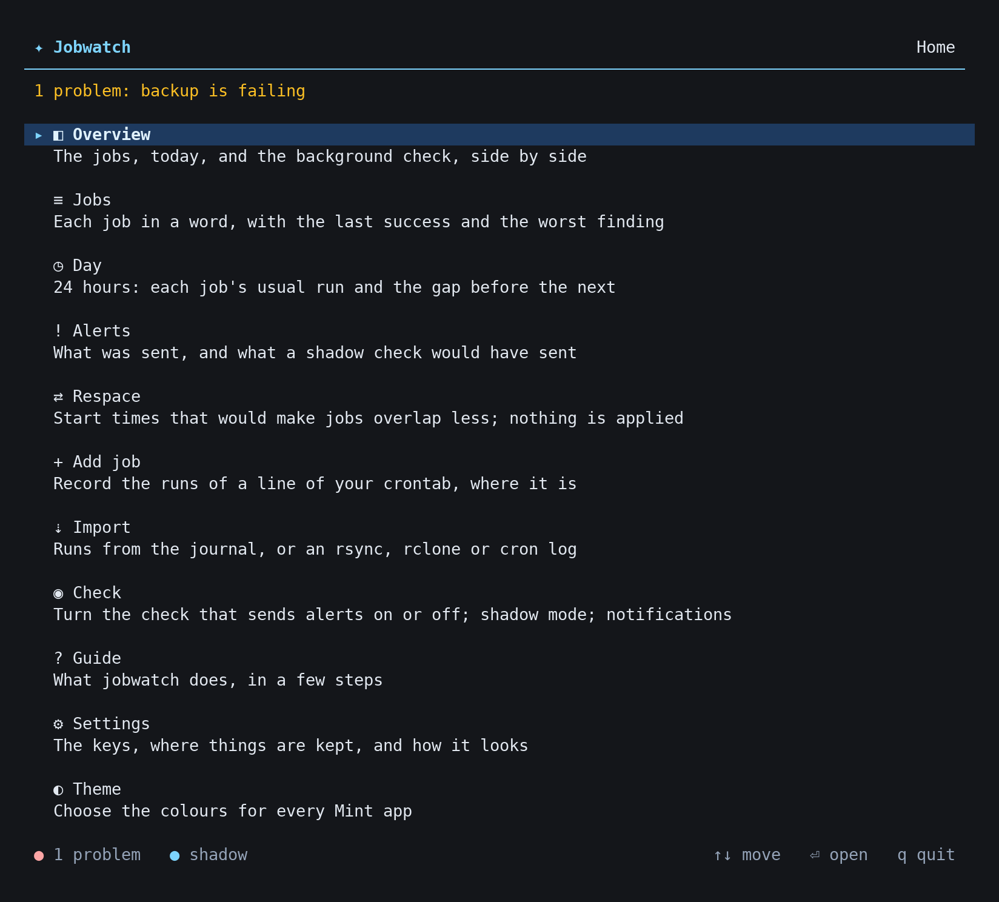
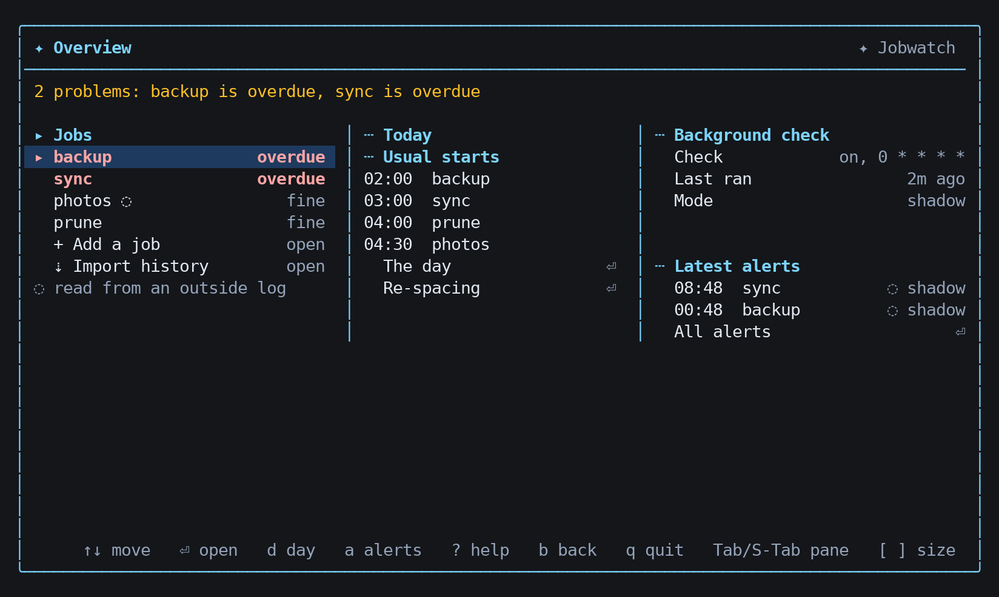
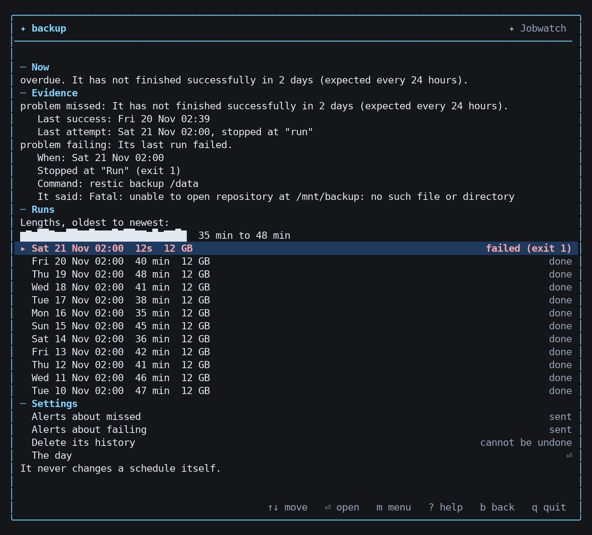
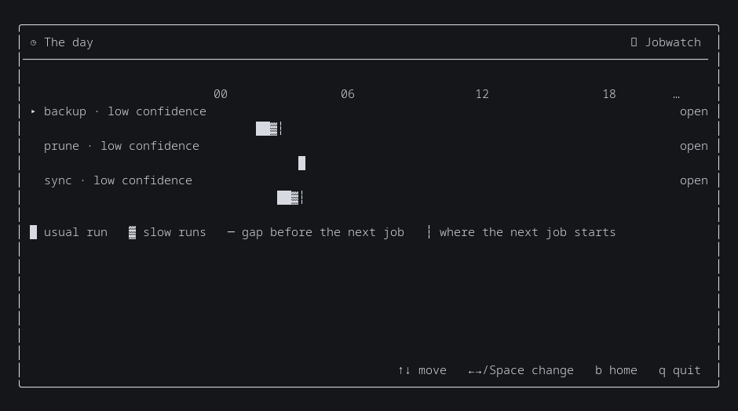
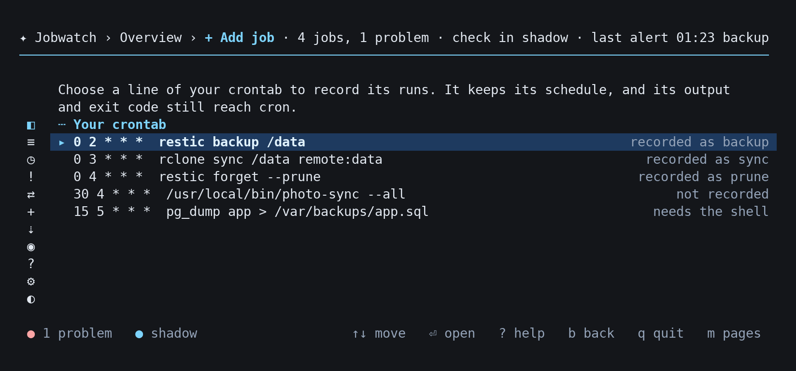
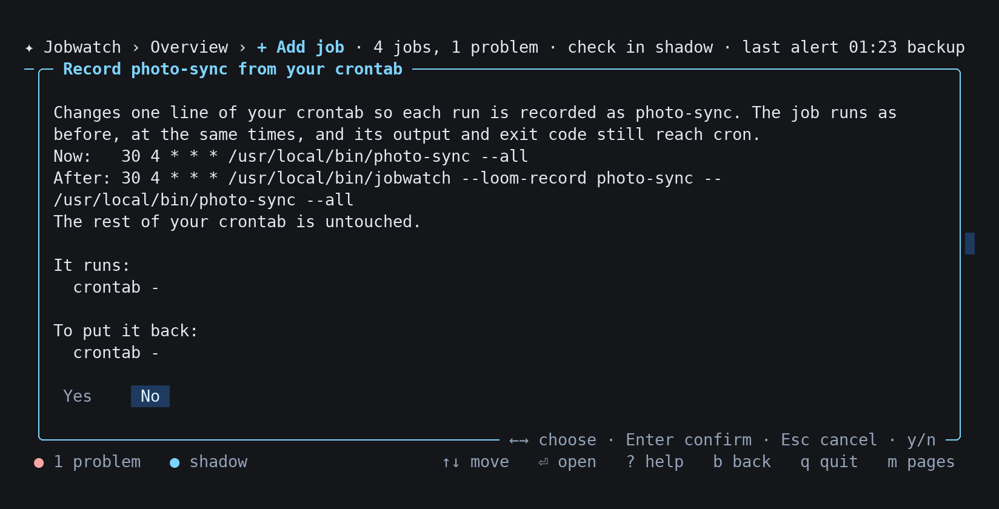
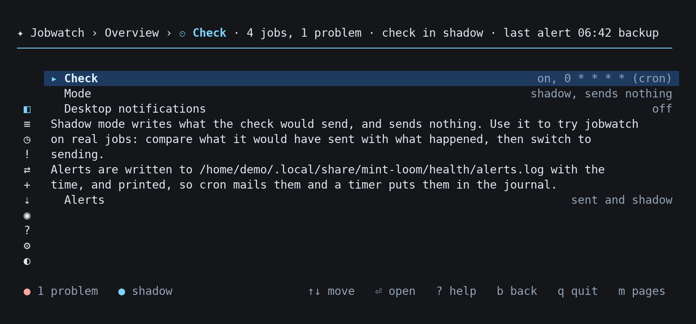
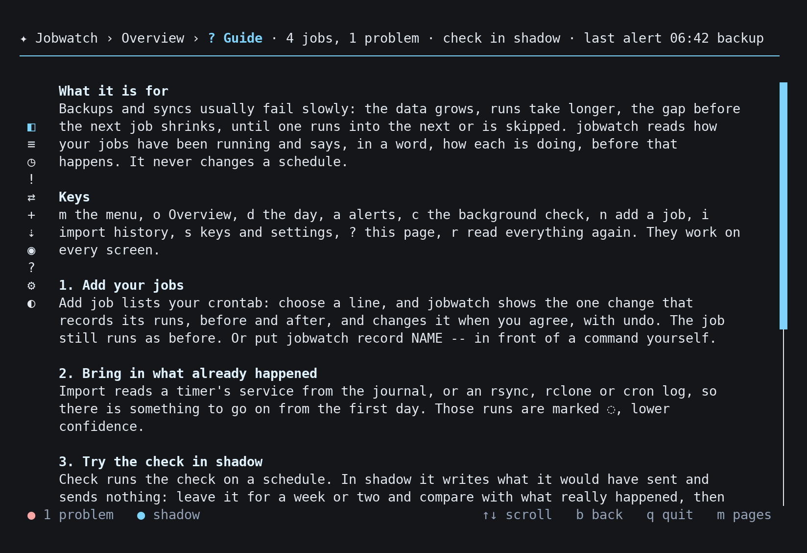
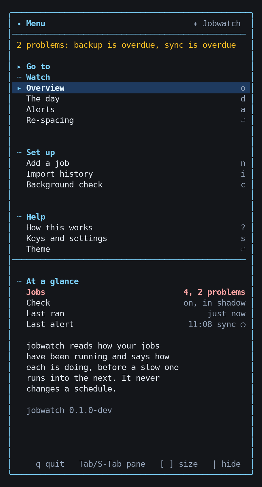

# jobwatch

Are my backup and sync jobs still working, and will they keep working? Without reading logs or checking cron.

Most backup failures are slow and predictable: data grows, runs take longer, the gap before the next job shrinks, and eventually one job runs into the next or is skipped. jobwatch reads how your jobs have been running and says, in a word, how each is doing, before that happens. **It never changes a schedule.**

A standalone terminal app built with [pmin](https://github.com/CurtisD4q/pmin), like [cairn](https://github.com/CurtisD4q/cairn) and [susynth](https://github.com/CurtisD4q/susynth): one program, no daemon, no database. The same program records your jobs, checks them in the background, and shows how they are doing.

**Install:** `curl -fsSL https://raw.githubusercontent.com/CurtisD4q/jobwatch/main/install.sh | sh` (Linux and macOS; [more ways below](#install)).



jobwatch opens on its launch menu. On every screen after that the pages run down the left (`m` moves into them), and the top line says where you are and how things stand: the jobs, the check and the latest alert.

## Screenshots

| | |
|---|---|
|  |  |
| **The overview.** The jobs worst first, today's usual starts, and the background check with its latest alerts. | **The evidence.** Open a job for every finding, with the numbers behind it, what the command said when it failed, and its runs. |
|  |  |
| **Day.** 24 hours across the terminal: the usual run, the slow tail, and how close it comes to the next job. | **Add job.** Your crontab, line by line, and whether each is recorded. |
|  |  |
| **One change, shown first.** The line before and after, and how to undo it, before anything is written. | **The background check.** Runs on a schedule; in shadow it writes what it would send and sends nothing. |
|  | |
| **Guide.** A one-page guide, one key away on every screen. | |

On a narrow terminal the panes stack, so it works over ssh from a phone:



## What it does

- **One word a job.** `fine`, `overdue`, `failing`, `slowing`, `overrunning`, `new`, `running`, `changed`: worst first, with the one thing most worth doing in the amber line at the top.
- **Missed and failed runs at once.** A job that hasn't succeeded in 1.5 times its period (plus ten minutes), or whose last run failed, is flagged from the first day, with the step that failed and the last thing it printed.
- **Trouble before it happens.** Slowing down with the same data, the slow runs eating the gap before the next job, jobs piling up at the same minute, a step to a new level: tested statistically, with the numbers shown.
- **The evidence, not a verdict.** Every finding shows the runs used, the test, and a date range rather than a single date.
- **A background check, tried safely.** It runs from your crontab or a systemd timer. Start it in **shadow**, where it writes what it would have sent and sends nothing; switch it to sending when you trust it.
- **Your history from day one.** Import a timer's service from the journal, or an rsync, rclone or cron log, so there is something to go on before jobwatch has recorded a run. Imported runs are marked ◌, lower confidence.
- **Respace, suggested.** Start times that would overlap less, for you to change by hand.

## Install

One command downloads the latest release, checks it against its checksum and installs it:

```
curl -fsSL https://raw.githubusercontent.com/CurtisD4q/jobwatch/main/install.sh | sh
```

That is the whole job: no Go, no source checkout and no access to any other repository is needed. `jobwatch` goes into `~/.local/bin`, with `jobwatch.el` for Emacs beside its data. It is one static program with nothing else to install. If that folder is not on your PATH, the installer prints the line to add. After that, run `jobwatch` from anywhere. To install for everyone in `/usr/local` instead, add `-s -- --system` after `sh`.

Or by hand: download the archive for your machine from Releases, check it against `SHA256SUMS`, unpack it and run `./jobwatch install`. The download can be deleted afterwards. To check that an archive was built from this repository by its release workflow: `gh attestation verify jobwatch-VERSION-linux-amd64.tar.gz --repo CurtisD4q/jobwatch`.

Arch users can build the `jobwatch-bin` package from [`packaging/aur`](packaging/aur), and Gentoo users the ebuild in [`packaging/gentoo`](packaging/gentoo); both install the release archive.

To remove it: `jobwatch uninstall`. Your settings and data are kept.

### Build from source

Most people do not need this; the install command above is enough. Building needs Go and access to the private pmin libraries, which are not public:

```
git clone https://github.com/CurtisD4q/jobwatch
cd jobwatch
export GOPRIVATE='github.com/CurtisD4q/*'
make install        # builds, then installs into ~/.local/bin
```

After `make install` the cloned folder can be deleted. To clone and fetch the libraries over SSH instead of HTTPS, tell git once: `git config --global url."git@github.com:".insteadOf "https://github.com/"`, and clone `git@github.com:CurtisD4q/jobwatch.git`.

## Getting started

Run `jobwatch`. It opens on the menu; with no jobs yet, the amber line there says where to start, and the overview (`o`) lists the first steps:

1. **Add job** (`n`). Choose a line of your crontab. jobwatch shows the one change that records its runs, before and after, and makes it when you agree, with undo. The job keeps its schedule, and its output and exit code still reach cron, so cron still mails a failure.
2. **Import** (`i`). Read a timer's service from the journal (yours or the system's), or an rsync, rclone or cron log.
3. **Turn on the background check, in shadow** (`c`). Leave it a week or two and compare what it would have sent with what really happened, then switch it to sending.
4. **Read the overview** (`o`). Missed and failed runs show at once. Slowing down, running into the next job and a step to a new level need some runs first, and say how sure they are.
5. **Open a job** (Enter) for the evidence. Mute a finding you already know about, or delete the job's history.

You can also record a job by hand: put `jobwatch record NAME --` in front of the command.

```
30 2 * * *  /usr/local/bin/jobwatch record nightly-backup -- restic backup /data
```

Six weeks later the overview says *"Nightly backup takes 31% longer per GB than 6 weeks ago (p = 0.01). The data has hardly changed, so it is slowing down, not growing."* Open it and you see the runs, the trend, and its slowest runs ending four minutes before the 03:00 sync starts. You move the sync by hand.

## Keys

The same on every screen:

| Key | Opens |
|---|---|
| `m` | The pages down the left: ↑↓ to choose, Enter to open, `m` or Esc to go back |
| `o` | Overview |
| `d` | Day |
| `a` | Alerts |
| `c` | Check |
| `n` | Add job |
| `i` | Import |
| `?` | Guide |
| `s` | Settings |
| `r` | Read the history and crontab again |

Arrows move, Enter opens or changes, Tab moves between panes, `[` `]` size them, `y` copies, `b` goes back, `q` quits. The mouse works too. `MINT_KEYS=emacs` or `vim` adds those key styles. Colours are jobwatch's own until you pick a theme on the Theme screen, or set `MINT_PALETTE`.

Screens update by themselves when a job records a run or the crontab changes.

## For scripts and cron

The same program has commands that run and exit. `jobwatch help` lists them:

```
jobwatch record NAME [--quiet] -- COMMAND...   run a job and record the run
jobwatch check [--shadow] [--notify] alert on problems: for a timer or cron
jobwatch schedule SPEC --on          run the check on a schedule (--undo turns it off)
jobwatch report | forecast | timeline [--json]
jobwatch import journal --unit UNIT [--user]   read history jobwatch did not record
jobwatch respace                     suggest start times; nothing is applied
```

`jobwatch --screen "Day"` opens one screen directly, and `jobwatch --version` says which version you have.

## Where things are kept

Everything is in `~/.local/share/mint-loom/` (or `$XDG_DATA_HOME/mint-loom`), private to you:

| | |
|---|---|
| `runs/` | one file a job: when each run started and ended, how it ended, and how much data it moved |
| `runs/imported/` | runs read from the journal or a log, kept apart from recorded ones |
| `recipes/` | each recorded job's command, and the background check's |
| `health/alerts.log` | alerts the check sent |
| `health/shadow.log` | what the check would have sent, in shadow |
| `health/mute.json` | findings you have muted |

Of what a command printed, the last 2,000 characters are kept, with passwords and tokens redacted; `jobwatch record NAME --quiet --` keeps none. What an imported log says is not kept, only the runs read from it. jobwatch sends nothing anywhere: alerts go to the log and standard output (so cron mails them and a timer puts them in the journal), and to a desktop notification if you turn that on.

`jobwatch --dir PATH` reads a history kept somewhere else, such as a copy of real runs to try jobwatch against. Cron runs jobwatch without `--dir`, so a history opened that way can be read but not scheduled from.

## What makes it trustworthy

- It says **"not enough runs yet"** rather than guessing. A trend needs 8 successful runs; a warning has to hold for three checks before it is sent, and a finding already sent is not sent again until it has gone away and come back.
- **Every finding shows its numbers**: the runs used, the test, and a date range rather than a single date.
- **Weekday and month-end cycles** are modelled before testing for a trend, so a heavy Monday is not reported as a slowdown.
- **False alarms are controlled across jobs**, so ten jobs tested at 5% do not produce a stream of spurious warnings.
- **Times are stored in UTC**, so daylight-saving changes do not create fake patterns.
- **Jobs without end times** (a cron log) are marked lower confidence.
- **Contention between jobs is always worded as a hint.** Moving one job is the test.

The false-alarm rate and the detection of planted faults are measured against a simulator, with a scorecard every change has to hold or improve. It lives in [pmin-jobhealth](https://github.com/CurtisD4q/pmin-jobhealth/blob/main/SCORECARD.md).

## Safety, and what it does not do

- **It never changes a schedule** and never stops or moves a job. Respace is a suggestion.
- **The crontab is changed only when you agree**, one line at a time, with the line before and after shown first and an undo. A line that needs the shell (a redirect, a pipe) is not changed; jobwatch says to put it in a script.
- **Recorded commands run directly, never through a shell**, with their output and exit code passed straight through.
- **Reading is read-only.** Import lists timers with `systemctl list-timers` and reads with `journalctl`; neither changes anything.

## Not tested here

jobwatch was built in a container without systemd, a running cron daemon or a desktop. Systemd timers, the journal and desktop notifications are tested against saved output only; the crontab is read and written with the real `crontab` command. Screens are checked at 52 and 100 columns in a terminal emulator library, not yet in every real terminal.

## Accessibility: where it stands

Built in: plain words throughout, state always written out (never colour alone), the same keys on every screen, keyboard and mouse, Emacs and vim key styles, and layouts that stack on a narrow terminal.

Not yet done: it has **not been tested with a screen reader or braille display**, or with people who have learning disabilities. A full-screen interface that redraws in place is hard for screen readers; until there is a plain mode, `jobwatch report` gives the same states as text. Treat the above as groundwork, not a claim.

## In Emacs

`jobwatch.el` is the same list and day inside Emacs. `M-x jobwatch` lists the jobs; `t` opens the day.

```
emacs -batch -l jobwatch.el -l jobwatch-test.el -f ert-run-tests-batch-and-exit
```

## Built from

jobwatch is a program built with pmin (tier `example` in `pmin.json`). [pmin-loom](https://github.com/CurtisD4q/pmin-loom) records the jobs and reads their history, [pmin-jobhealth](https://github.com/CurtisD4q/pmin-jobhealth) (the engine behind Loom's health checks) judges them, and [pmin-kit](https://github.com/CurtisD4q/pmin-kit) draws the screens. Loom never imports the engine, so jobwatch uses pmin-jobhealth directly: its checks, alert tracking, mutes and the day picture. The checks, the simulator and the scorecard live in pmin-jobhealth; jobwatch's own commands (`internal/jw`) and screens (`internal/screens`) live here.

## Licence

Apache-2.0.
